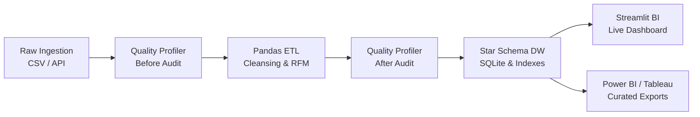

# OmniCart | End-to-End E-Commerce Data Engineering Solution

[](https://www.python.org/)
[](https://sqlite.org/)
[](https://streamlit.io/)
[](https://pytest.org/)

An enterprise-grade, end-to-end data engineering solution that automates multi-entity transactional ingestion, empirical data quality profiling, Kimball Star Schema dimensional modeling, and interactive business intelligence analytics.

---

## 📌 Problem Statement (5-6 Lines)
Modern e-commerce enterprises generate millions of fragmented transactional data points across customer profiles, product catalogs, multi-channel payment gateways, and third-party logistics fulfillment networks. This fragmentation severely impacts operations directors, supply chain managers, and commercial growth teams who lack unified visibility into order fulfillment bottlenecks, shipping SLA breaches, and customer churn drivers. Without clean, standardized, and modeled dimensional data, business leaders face delayed delivery escalations, inaccurate revenue attribution, and wasted marketing spend. This end-to-end data engineering solution automates multi-entity ingestion, profiles and remediates data quality anomalies, builds an optimized Star Schema data warehouse, and powers interactive BI reporting to guide carrier renegotiation, regional inventory restocking, and customer retention strategies.

---

## 🏗️ Architecture & Pipeline Flow



---

## 📂 Project Structure

```
DataScienceProj/
├── data/
│   ├── raw/                      # Ingested raw datasets (7 core entities)
│   ├── processed/                # Cleaned staged datasets & quality JSONs
│   └── warehouse/                # Star Schema DB & Power BI exports
│       ├── ecommerce_dw.db       # SQLite Relational Data Warehouse
│       └── powerbi_export/       # Clean CSV tables ready for Power BI / Tableau
├── src/
│   ├── __init__.py
│   ├── utils.py                  # Paths, unified logger, timing decorators
│   ├── ingestion.py              # Stage 1: Automated multi-entity raw data generator/loader
│   ├── quality_assessment.py     # Stage 2: Data quality profiler & before/after auditor
│   ├── transformation.py         # Stage 3: ETL logic, SLA calculations, RFM segmentation
│   ├── models.sql                # Star schema DDL, indexes, and analytical views
│   ├── storage.py                # Stage 4: Star schema loader & integrity auditor
│   └── distributed_spark_etl.py  # Stage 5: Apache Spark big data scaling blueprint
├── dashboard/
│   └── app.py                    # Stage 6: Interactive Streamlit BI Dashboard
├── docs/
│   ├── PROJECT_REPORT.md         # Comprehensive Mini Project academic report
│   ├── ARCHITECTURE.md           # Technical architecture & pipeline lifecycle
│   ├── SCHEMA_ERD.md             # Star Schema ER diagram & data dictionary
│   ├── DATA_QUALITY_REPORT.md    # Empirical before-and-after data quality audit
│   └── VIVA_PREP.md              # 25+ Viva Voce questions & 10-12 min presentation guide
├── tests/
│   └── test_pipeline.py          # Automated pipeline test suite (pytest)
├── requirements.txt              # Production dependency specifications
├── run_pipeline.py               # Single master command orchestrator
└── README.md
```

---

## 🚀 Quickstart & Setup Guide

### 1. Prerequisites & Environment Setup
Clone the repository and install dependencies:
```bash
git clone https://github.com/yashgutte13-ux/DataScienceProj.git
cd DataScienceProj
pip install -r requirements.txt
```

### 2. Run the Full End-to-End Pipeline (One Command)
Execute all stages (Ingestion -> Profiling Before -> Transformation -> Profiling After -> Storage -> Power BI Export):
```bash
python run_pipeline.py
```
*Expected Execution Duration: ~20-25 seconds on a standard laptop.*

### 3. Launch the Interactive BI Dashboard
Start the Streamlit BI web application:
```bash
streamlit run dashboard/app.py
```
Open [http://localhost:8501](http://localhost:8501) in your browser.

### 4. Run Automated Tests
Execute the automated test suite verifying data integrity, deduplication, and schema constraints:
```bash
python -m pytest tests/test_pipeline.py -v
```

---

## 📊 Business Intelligence Dashboard Features

The dashboard includes 6 analytical modules:
1. **🌟 Executive Overview:** High-level KPI metrics (Gross Revenue, Orders, Average Order Value, On-Time SLA %, Review Scores) and monthly revenue trajectories.
2. **🚚 Logistics & Delivery SLA:** State-by-state on-time fulfillment rates, delay distributions, and carrier breach counts.
3. **👥 Customer RFM Segments:** Behavioral customer tiers (*Champions*, *Loyal*, *At Risk*, *Lost*) with spend treemaps and retention insights.
4. **📦 Product Category Matrix:** Category revenue ranking, average price vs. customer satisfaction matrix.
5. **🔍 SQL Query Studio:** Live ad-hoc SQL query console against `ecommerce_dw.db` with query execution timer and CSV export.
6. **🛡️ Data Quality & Architecture:** Empirical Before-vs-After quality audit benchmarks and pipeline lineage diagrams.

---

## 📑 Course Deliverables & Documentation Index

- [Mini Project Final Report](file:///docs/PROJECT_REPORT.md)
- [Technical Architecture & Data Flow](file:///docs/ARCHITECTURE.md)
- [Star Schema ER Diagram & Data Dictionary](file:///docs/SCHEMA_ERD.md)
- [Empirical Data Quality Audit Report](file:///docs/DATA_QUALITY_REPORT.md)
- [Viva Voce & Final Presentation Prep Guide](file:///docs/VIVA_PREP.md)

---

## 🔒 Security & Academic Integrity
- **No Passwords or Secrets:** Zero hardcoded API keys or credentials.
- **Reproducible Seed:** Ingestion uses deterministic seeds (`seed=42`) ensuring verifiable data engineering benchmarks.
