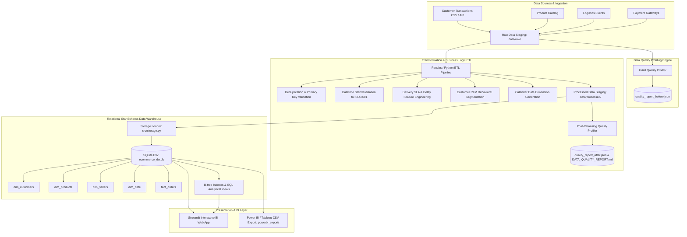

# Technical Architecture & Data Flow Specification

## 1. High-Level Architecture Diagram



---

## 2. Pipeline Layers & Lifecycle

### Layer 1: Ingestion Layer (`src/ingestion.py`)
- **Responsibility:** Automated collection, extraction, and staging of transactional data.
- **Input:** External feeds (CSV files, REST API batch simulations, database extracts).
- **Output:** Staged raw files in `data/raw/` preserving raw input fidelity without premature filtering.

### Layer 2: Data Quality Assessment Layer (`src/quality_assessment.py`)
- **Responsibility:** Objective profiling across Completeness, Uniqueness, Validity, and Outlier distributions.
- **Workflow:** Runs before and after transformations, outputting comparative JSON profiles and generating `docs/DATA_QUALITY_REPORT.md`.

### Layer 3: Transformation & Enrichment Layer (`src/transformation.py`)
- **Responsibility:** Cleansing anomalies, imputing missing values, enforcing casing consistency, and feature-engineering analytical metrics (Delivery SLA, RFM customer tiers).
- **Output:** Staged analytical tables in `data/processed/`.

### Layer 4: Storage & Data Warehouse Layer (`src/storage.py` & `src/models.sql`)
- **Responsibility:** Kimball Star Schema modeling. Generates surrogate primary keys, enforces foreign key referential integrity, builds query indexes, and encapsulates common analytics into SQL Views.
- **Output:** SQLite database (`data/warehouse/ecommerce_dw.db`) and CSV dumps for external BI tools (`data/warehouse/powerbi_export/`).

### Layer 5: BI & Visualization Layer (`dashboard/app.py`)
- **Responsibility:** Self-service interactive analytics, KPI tracking, cohort heatmaps, and ad-hoc SQL querying.

---

## 3. Distributed Scaling Blueprint (PySpark / Cloud)

For production enterprise workloads handling petabyte-scale data:
```
[ Kafka / Kinesis Streaming Ingestion ]
                  │
                  ▼
[ Raw Data Lake (Amazon S3 / Google Cloud Storage - Parquet format) ]
                  │
                  ▼
[ Apache Spark / Databricks Distributed Cluster (PySpark Catalyst Optimizer) ]
                  │
                  ├── Distributed Window Partitioning (RFM & Delivery Durations)
                  ├── Distributed Shuffling & Deduplication
                  └── Predicate Pushdown & Columnar Pruning
                  │
                  ▼
[ Cloud Data Warehouse: Snowflake / Databricks Delta Lake / Google BigQuery ]
                  │
                  ▼
[ Power BI / Tableau / Metabase Enterprise BI Dashboards ]
```
The blueprint is fully coded and documented in `src/distributed_spark_etl.py`.
