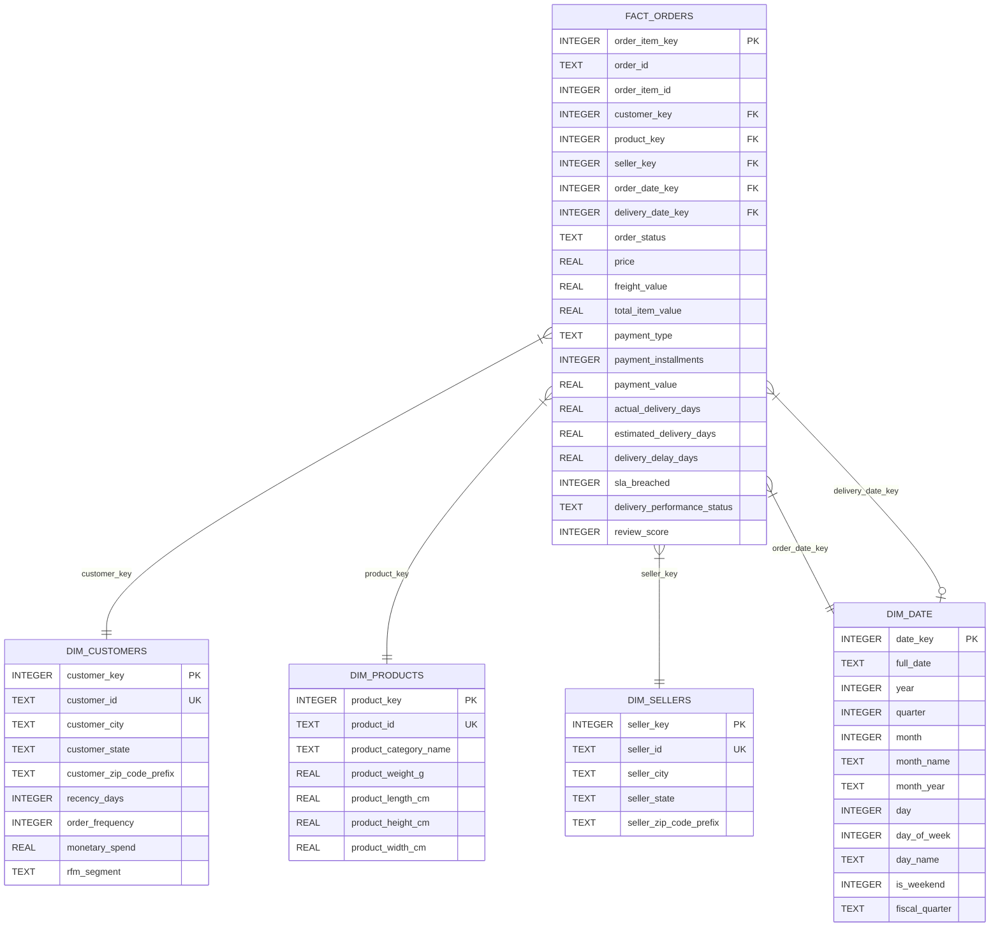

# Star Schema Entity-Relationship (ER) Diagram & Data Dictionary

## 1. Star Schema Entity Relationship Diagram

---

## 2. Table Specifications & Grain Definitions

### Fact Table: `fact_orders`
- **Grain:** One row per individual item purchased in an order.
- **Surrogate Key:** `order_item_key` (INTEGER AUTOINCREMENT).
- **Business Keys:** `(order_id, order_item_id)`.
- **Measures / Metrics:**
  - `price`: Unit price of the item.
  - `freight_value`: Shipping and handling fee charged.
  - `total_item_value`: `price + freight_value`.
  - `actual_delivery_days`: Total duration from purchase to customer doorstep.
  - `estimated_delivery_days`: Estimated promised transit duration.
  - `delivery_delay_days`: Delay beyond estimated promise date.
  - `sla_breached`: Binary indicator (`1` if delayed, `0` if on-time).
  - `review_score`: Satisfaction rating (1 to 5).

### Dimension Table: `dim_customers`
- **Grain:** One row per registered customer.
- **Surrogate Key:** `customer_key` (INTEGER AUTOINCREMENT).
- **Attributes:** City, State, Zip Prefix, RFM Metrics (`recency_days`, `order_frequency`, `monetary_spend`, `rfm_segment`).

### Dimension Table: `dim_products`
- **Grain:** One row per unique catalog product.
- **Surrogate Key:** `product_key` (INTEGER AUTOINCREMENT).
- **Attributes:** Normalized category name, physical dimensions (weight, length, height, width).

### Dimension Table: `dim_sellers`
- **Grain:** One row per marketplace merchant/seller.
- **Surrogate Key:** `seller_key` (INTEGER AUTOINCREMENT).
- **Attributes:** Seller ID, Hub City, State, Postal prefix.

### Dimension Table: `dim_date`
- **Grain:** One row per calendar day.
- **Key:** `date_key` in format `YYYYMMDD` (e.g., `20230514`).
- **Attributes:** Year, Quarter, Month, Day, Day of Week, Is Weekend, Fiscal Quarter.

---

## 3. Pre-Built SQL Analytical Views

1. `vw_executive_kpis`: High-level executive aggregates (GMV, order volume, on-time delivery SLA %, avg review).
2. `vw_monthly_revenue_trend`: Time-series revenue, freight income, and satisfaction trends by month.
3. `vw_delivery_sla_performance`: Regional delivery performance and SLA breach counts by state.
4. `vw_customer_rfm_summary`: Customer count, CLV, and spend breakdown by RFM segment.
5. `vw_product_category_performance`: Sales volume, unit economics, and satisfaction by category.
